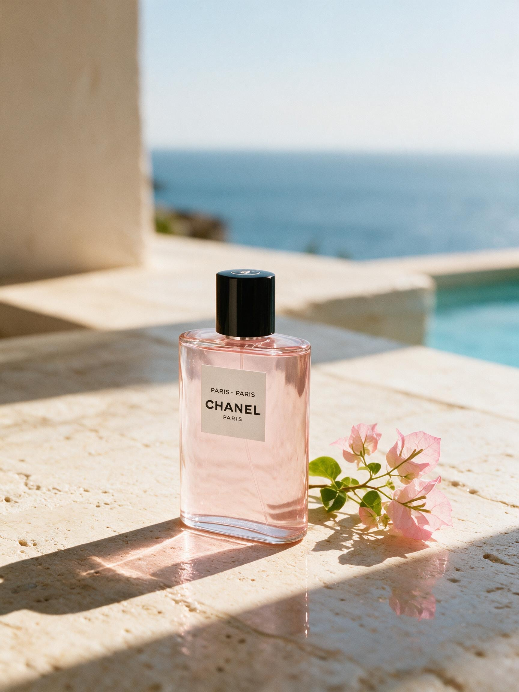
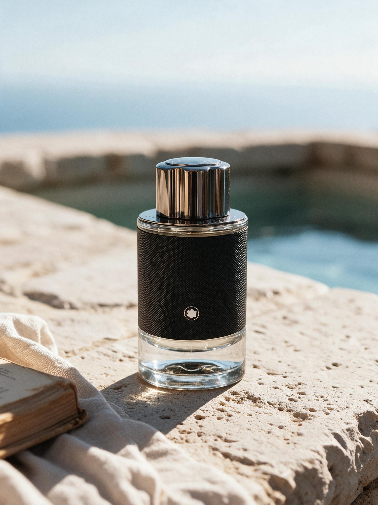
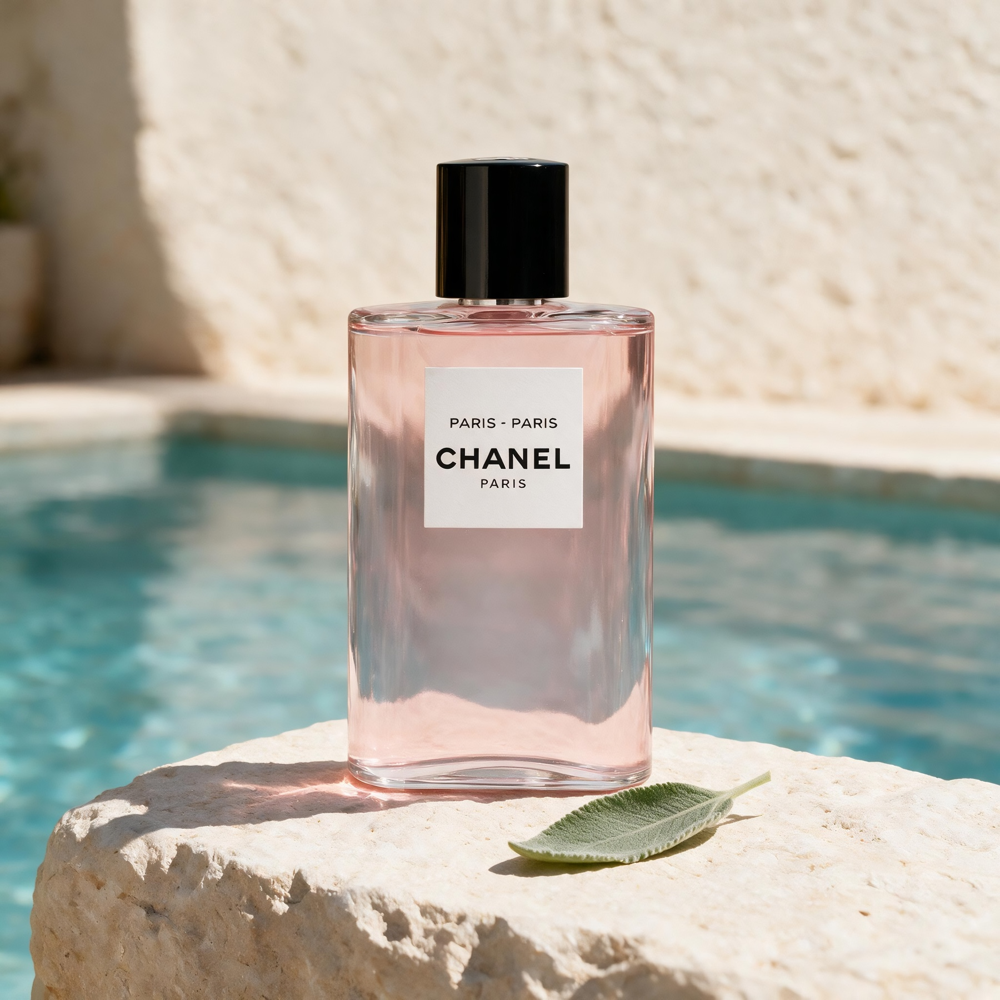
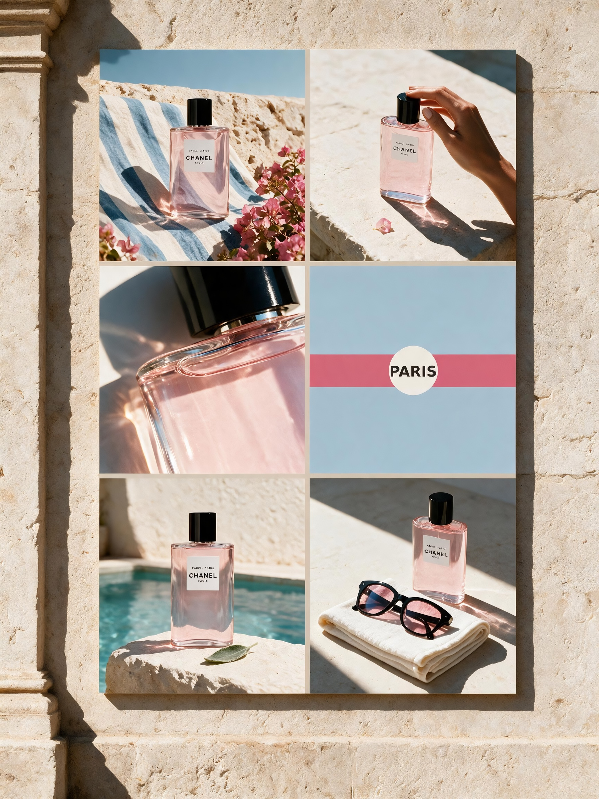

# xhs-resort-editorial

为产品生成 3:4 小红书视觉的 Codex Skill。它提炼了阳光度假、南法午后、奢品静物与编辑式拼贴的视觉语言，可用于香水、美妆、珠宝和生活方式品牌；生成时保留用户提供的产品外观，不照搬参考作品的具体构图。

## 效果示例

<table>
  <tr>
    <td width="50%"></td>
    <td width="50%"></td>
  </tr>
  <tr>
    <td width="50%"></td>
    <td width="50%"></td>
  </tr>
</table>

支持四类核心构图：生活方式主视觉、编辑式产品静物、建筑海报墙和品牌 campaign mosaic。

## 使用示例

```text
使用 $xhs-resort-editorial，把这款香水做成 Aura 类南法午后风格的 3:4 小红书封面。
```

## 安装

将本仓库克隆到 Codex 的 Skill 目录：

```bash
git clone https://github.com/Jingyi-Wu-Richael/xhs-resort-editorial.git ~/.codex/skills/xhs-resort-editorial
```

安装后即可通过 `$xhs-resort-editorial` 调用。完整规则见 [SKILL.md](SKILL.md)。
